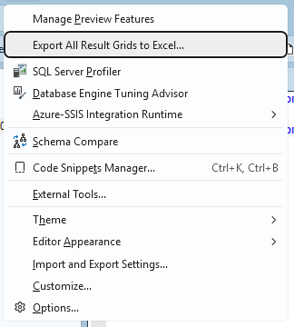

# SSMS Excel Export

An SQL Server Management Studio 22 extension that exports **every result grid** of the active query window into **one `.xlsx` file, one sheet per grid**.



## Usage

1. Run a query in SSMS (multiple result sets are fine).
2. Choose **Tools > Export All Result Grids to Excel...** (also available from the query editor's right-click menu).
3. Pick a file name. Sheets are named `Result 1`, `Result 2`, and so on.

## How it works

- Reads the grids already on screen through SSMS's brokered services (`IQueryEditorTabDataServiceBrokered`). The query is **not** re-run.
- Rows are fetched in pages of 5,000, so large result sets don't need to fit in one call.
- Each sheet has a bold header row, a frozen header and an auto-filter.
- Plain numbers are written as numbers. Values such as `007`, dates and everything else stay as text, and `NULL` becomes an empty cell.
- Excel limits apply: 1,048,576 rows per sheet and 32,767 characters per cell.

## Install

1. Build it (below) or download the `.vsix`.
2. Close SSMS and double-click `SsmsExcelExport.vsix`.
3. Reopen SSMS.

## Build

Uses the MSBuild bundled with SSMS 22, with references pointing at the SSMS install folder:

```
"C:\Program Files\Microsoft SQL Server Management Studio 22\Release\MSBuild\Current\Bin\MSBuild.exe" SsmsExcelExport.csproj -restore -p:Configuration=Release
```

Output: `bin\Release\SsmsExcelExport.vsix`.

## Caveat

The brokered services used here are internal SSMS contracts (the ones SSMS's own Copilot agent uses), so a future SSMS update could change them.
